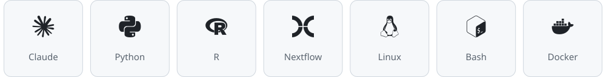
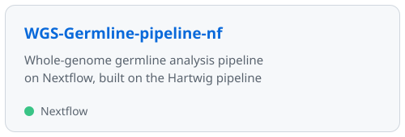
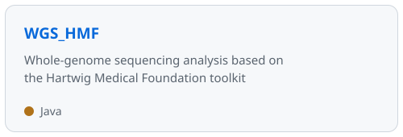
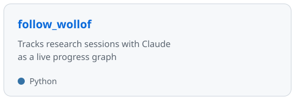
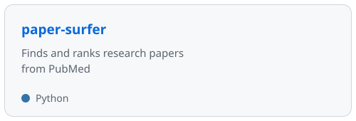

  

### About

Integrated M.S./Ph.D. student at **Yonsei University College of Medicine**, Seoul.
I study cancer through whole-genome sequencing: somatic and germline variation, tumor evolution, and mutation timing.
On the side, I build small tools that automate the research workflow with LLM agents.

### Tech Stack

<picture>
  <source media="(prefers-color-scheme: dark)" srcset="assets/stack-dark.svg" />
  
</picture>

### Projects

<a href="https://github.com/Sejung98/WGS-Germline-pipeline-nf"><picture><source media="(prefers-color-scheme: dark)" srcset="assets/card-WGS-Germline-pipeline-nf-dark.svg" /></picture></a><a href="https://github.com/Sejung98/WGS_HMF"><picture><source media="(prefers-color-scheme: dark)" srcset="assets/card-WGS_HMF-dark.svg" /></picture></a>
<a href="https://github.com/Sejung98/follow_wollof"><picture><source media="(prefers-color-scheme: dark)" srcset="assets/card-follow_wollof-dark.svg" /></picture></a><a href="https://github.com/Sejung98/paper-surfer"><picture><source media="(prefers-color-scheme: dark)" srcset="assets/card-paper-surfer-dark.svg" /></picture></a>

### Activity

<picture>
  <source media="(prefers-color-scheme: dark)" srcset="https://streak-stats.demolab.com?user=Sejung98&theme=github-dark-blue&background=00000000&hide_border=true" />
  
</picture>

