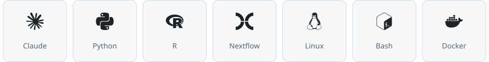
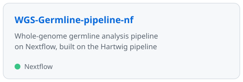
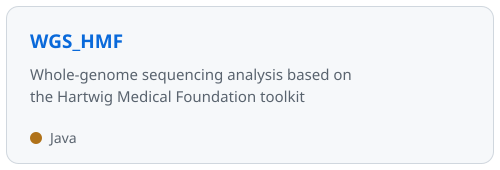
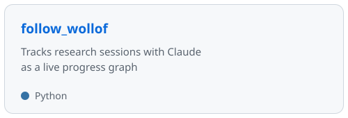
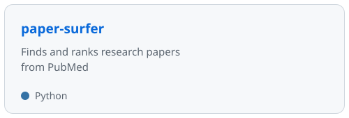
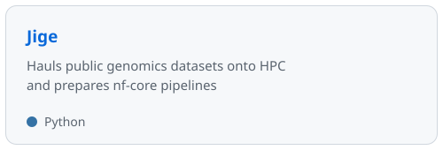

  

### About

Integrated M.S./Ph.D. student at **Yonsei University College of Medicine**, Seoul.
I study cancer through whole-genome sequencing: somatic and germline variation, tumor evolution, and mutation timing.
On the side, I build small tools that automate the research workflow with LLM agents.

### Tech Stack

<picture>
  <source media="(prefers-color-scheme: dark)" srcset="assets/stack-dark.svg" />
  
</picture>

### Cancer Genomics

Whole-genome pipelines for somatic and germline variation.

<a href="https://github.com/Sejung98/WGS-Germline-pipeline-nf"><picture><source media="(prefers-color-scheme: dark)" srcset="assets/card-WGS-Germline-pipeline-nf-dark.svg" /></picture></a><a href="https://github.com/Sejung98/WGS_HMF"><picture><source media="(prefers-color-scheme: dark)" srcset="assets/card-WGS_HMF-dark.svg" /></picture></a>

Tools I fork and use for tumor evolution and long-read work: [PhylogicNDT](https://github.com/Sejung98/PhylogicNDT) · [MutationTimeR](https://github.com/Sejung98/MutationTimeR) · [gritic](https://github.com/Sejung98/gritic) · [Evolution](https://github.com/Sejung98/Evolution) (PCAWG) · [pacsomatic](https://github.com/Sejung98/pacsomatic) (PacBio HiFi, Nextflow)

<a href="https://github.com/search?q=user%3ASejung98+topic%3Acancer-genomics&type=repositories">All cancer genomics repositories</a>

### Research Agents

LLM agents that automate parts of the research workflow.

<a href="https://github.com/Sejung98/follow_wollof"><picture><source media="(prefers-color-scheme: dark)" srcset="assets/card-follow_wollof-dark.svg" /></picture></a><a href="https://github.com/Sejung98/paper-surfer"><picture><source media="(prefers-color-scheme: dark)" srcset="assets/card-paper-surfer-dark.svg" /></picture></a>
<a href="https://github.com/Sejung98/Jige"><picture><source media="(prefers-color-scheme: dark)" srcset="assets/card-Jige-dark.svg" /></picture></a>

<a href="https://github.com/search?q=user%3ASejung98+topic%3Aresearch-agents&type=repositories">All research agent repositories</a>

### Currently Learning

Single-cell and spatial omics, multimodal integration with WGS, and deep learning with PyTorch.

### Activity

<picture>
  <source media="(prefers-color-scheme: dark)" srcset="https://streak-stats.demolab.com?user=Sejung98&theme=github-dark-blue&background=00000000&hide_border=true" />
  
</picture>

